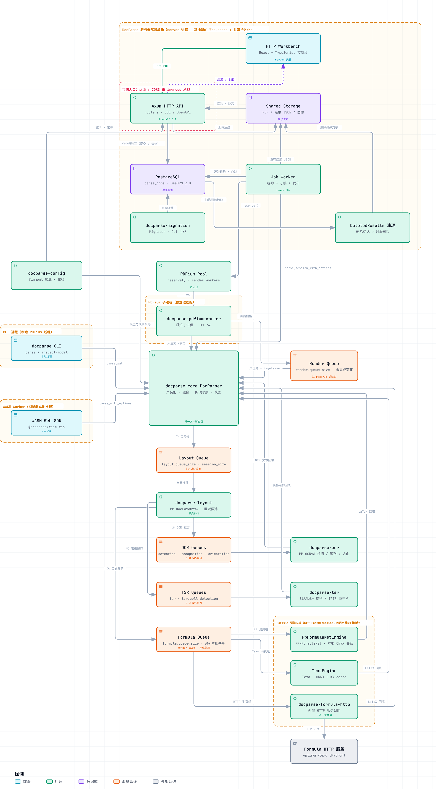

# DocParse

[English](README.md) | [简体中文](README.zh-CN.md)

DocParse is a Rust PDF parsing pipeline with a native CLI, a durable HTTP service, and a browser WASM SDK. It combines PDFium text extraction and rendering with layout detection, table reconstruction, OCR, and formula recognition, then produces validated JSON and Markdown.

Start with the [deployment guide](DEPLOYMENT.md) ([中文部署指南](DEPLOYMENT.zh-CN.md)) for prerequisites, model downloads, build commands, runtime files, and verification.

## Contents

- [Deployment](#deployment): [CLI](DEPLOYMENT.md#cli) · [Web Server](DEPLOYMENT.md#web-server-and-http-workbench) · [WASM SDK](DEPLOYMENT.md#wasm-browser-sdk)
- [Pipeline and output](#pipeline-and-output)
- [Configuration](#configuration)
- [Rust library](#rust-library)
- [Repository map](#repository-map)
- [Development and verification](#development-and-verification)
- [Licensing](#licensing)

## Deployment

Prepare [tools](DEPLOYMENT.md#prepare-tools), [models](DEPLOYMENT.md#download-and-verify-models), and the [native backend](DEPLOYMENT.md#native-inference-backends), then choose a build and run guide below.

### Choose an integration

| Integration | Where parsing runs | Deliverables | Runtime requirements | Best suited to |
| --- | --- | --- | --- | --- |
| [CLI deployment](DEPLOYMENT.md#cli) | Local native process | `docparse` executable | Models, PDFium, and the selected inference backend | Local files, scripts, batch processing |
| [Web Server deployment](DEPLOYMENT.md#web-server-and-http-workbench) | Native server and PDFium child processes | `docparse-server`, `docparse-pdfium-worker`, optional HTTP workbench | Models, PostgreSQL, shared storage, native libraries | Durable jobs, HTTP clients, shared GPU service |
| [WASM SDK deployment](DEPLOYMENT.md#wasm-browser-sdk) | Browser module Worker | Static ES modules, WASM, ORT Web assets | Static hosting, separately hosted models, compatible browser | Browser-local parsing without a parsing server |

The [HTTP workbench](packages/web/README.md) uploads PDFs to the native server and reads persisted results. The WASM example parses locally in the browser. Selecting an external HTTP formula engine sends formula crops to that service in either integration.

For deployment operations, jump to [configuration and resource limits](DEPLOYMENT.md#configuration-and-resource-limits), [native packaging](DEPLOYMENT.md#package-native-artifacts), or [verification and troubleshooting](DEPLOYMENT.md#deployment-verification-and-troubleshooting).

### Quick start: native CLI

Install stable Rust and uv, and run these commands from the repository root. The model command downloads the complete catalog, including optional alternatives; the deployment guide also shows how to download only the models used by the shipped configuration.

On macOS, prepare and copy the verified TATR installation from Linux first: its
current exporter dependencies have no macOS wheel. See the
[TATR platform steps](DEPLOYMENT.md#tatr-on-macos) before the model command below.

```sh
uv run --locked scripts/download_models.py
uv run --locked scripts/download_models.py --verify-only
cargo build --locked --release -p docparse-cli
./target/release/docparse inspect-model --config docparse.toml
./target/release/docparse parse input.pdf --config docparse.toml \
  --format json --output result.json
./target/release/docparse parse input.pdf --config docparse.toml \
  --format markdown --view semantic --output result.md
```

Replace `input.pdf` with your PDF. File output is atomic and refuses to overwrite an existing file unless `--force` is supplied. `cargo build` creates the executable under `target/release/`; it does not install `docparse` on your `PATH`.

CPU is the default. Native CLI and server builds support unified `cuda`, `tensorrt`, `coreml`, `metal`, and `openvino` Cargo features. See [backend selection](DEPLOYMENT.md#native-inference-backends) before choosing an accelerator; do not use `--all-features`.

## Pipeline and output



PDFium supplies native text and page images; PP-DocLayoutV3 detects candidate regions. The shipped [docparse.toml](docparse.toml) uses TATR with wireless RT-DETR cells for tables, PP-OCRv6 for missing text, and Texo for inline and display formulas. Local table rules, SLANet+/SLANeXt, PP-FormulaNet, and external HTTP formula services are also supported.

`docparse-core` assigns each native text fact exactly once, retains source geometry and evidence, and computes reading order. Residual XY-cut preserves text outside model regions or after recoverable layout failures. Table cells and formula anchors reference the original text rather than duplicating its ownership.

JSON preserves the document schema, text, tables, formulas, images, warnings, and relations. Markdown offers raw and semantic views; the semantic view suppresses repeated page furniture at presentation time. Formula recognition adds LaTeX and Markdown while retaining source text. Recoverable failures remain visible in page warnings and document errors.

`reference` is a visual annotation; bibliography text uses `reference_content`. Partially intersecting content regions remain separate and report `ContentLayoutOverlap`. Watermarks remain independent blocks; rotated content retains precise polygons when available.

Architecture labels are Simplified Chinese. The [SVG](docs/architecture/docparse-architecture.svg) and [Archify source](docs/architecture/docparse-architecture.archify.json) are kept alongside the image. Algorithm and schema details live in [docparse-core](crates/core/README.md) and the [design documents](docs/superpowers/specs/).

## Configuration

[docparse.toml](docparse.toml) is a complete native example, not an automatic hardware profile. Relative model paths resolve beside the primary configuration file. CLI configuration precedence is code defaults, primary TOML, selected profile, `DOCPARSE_...` environment variables, then explicit caller overrides.

Without `--config`, the CLI reads exactly `./docparse.toml`; it does not search parent directories. Rust libraries load configuration only when requested. Native backends are fixed at compile time; TOML `execution_provider` overrides are rejected. WASM receives model URLs/bytes and a JavaScript configuration object instead of reading native files or environment variables.

All render and model queue capacities must be supplied, including for disabled model sections. The shipped configuration enables OCR and uses `tsr_only`; native library defaults disable OCR and use rules-first table fallback. The WASM SDK selects TATR and rules-first fallback, with OCR disabled unless requested; the browser example enables automatic OCR.

Use the [deployment guide](DEPLOYMENT.md#configuration-and-resource-limits) for path resolution, concurrency, logs, and required queues. The [TSR](crates/tsr/README.md), [OCR](crates/ocr/README.md), [formula](crates/formula/README.md), [Texo](crates/formula-texo/README.md), and [HTTP formula](crates/formula-http/README.md) guides cover their specific settings.

## Rust library

Native applications can use `docparse-core` directly without an HTTP server:

```rust,no_run
use docparse_config::{ConfigLoader, ValidatedConfig};
use docparse_core::DocParser;

# /// Demonstrates explicit native configuration loading and parsing.
# async fn example() -> Result<(), Box<dyn std::error::Error>> {
let raw = ConfigLoader::new("docparse.toml").load_raw()?;
let parser = DocParser::from_config(ValidatedConfig::try_from(raw)?).await?;
let document = parser.parse_path("input.pdf").await?;
# Ok(())
# }
```

Reuse the parser so models stay loaded. Native asynchronous APIs require Tokio; use `parse_path_blocking` only outside an existing Tokio runtime. `DocParserBuilder` supports injected layout, OCR, table, and glyph engines. Browser applications should use the SDK lifecycle API, which initializes PDFium, WASI, and ORT Web in the same Worker.

## Repository map

| Path | Responsibility |
| --- | --- |
| [crates/cli](crates/cli/README.md) | CLI arguments and output |
| [crates/core](crates/core/README.md) | PDF extraction, fusion, parser, schema, renderers |
| [crates/common](crates/common/README.md), [crates/config](crates/config/README.md) | Queues, resource lifetimes, configuration |
| [crates/layout](crates/layout/README.md), [crates/tsr](crates/tsr/README.md), [crates/ocr](crates/ocr/README.md) | Layout, table, and OCR models |
| [crates/formula](crates/formula/README.md), [crates/formula-texo](crates/formula-texo/README.md), [crates/formula-http](crates/formula-http/README.md) | Local and external formula engines |
| [crates/server](crates/server/README.md), [crates/database](crates/database/README.md), [crates/migration](crates/migration/README.md) | HTTP jobs, persistence, migrations |
| [packages/web](packages/web/README.md) | HTTP workbench |
| [crates/web](crates/web/README.md), [packages/wasm-web](packages/wasm-web/README.md) | Browser ABI, SDK, and local parsing example |
| [scripts](scripts/README.md) | Model provisioning, compatibility checks, real-PDF E2E tools |
| [optimum-texo](optimum-texo/README.md) | Optional external formula service |

## Development and verification

Default workspace commands select native crates and omit the browser-only crate:

```sh
cargo fmt --all -- --check
cargo test --locked
cargo clippy --locked --all-targets -- -D warnings
uv run --locked scripts/check_wasm_compat.py
```

Explicit native `--workspace` checks need `--exclude docparse-web`. Build the browser SDK separately with the [WASM deployment steps](DEPLOYMENT.md#wasm-browser-sdk). Frontend builds and browser acceptance commands are in the corresponding package guides.

Model parity and real-PDF acceptance are separate from fixture tests. The [Python tools guide](scripts/README.md) describes dependency groups and commands. The native corpus runner checks PDF identities against [tests/e2e-corpus.toml](tests/e2e-corpus.toml); a smoke run with `--only` is not full acceptance. Historical [benchmark reports](docs/reports/) describe their recorded environment, not guarantees for a new deployment.

## Licensing

DocParse source is Apache-2.0. PDFium, ONNX Runtime, models, and other bundled assets retain their own licenses. The model downloader records Texo as AGPL-3.0 and TATR as MIT; model terms are separate from the Rust source license. See [LICENSE](LICENSE), [NOTICE](NOTICE), and [THIRD_PARTY_NOTICES.md](THIRD_PARTY_NOTICES.md) when distributing binaries, models, or browser assets.

User PDFs, downloaded models, build output, and generated acceptance reports are excluded from Git. Small regression fixtures and their licenses are versioned.
